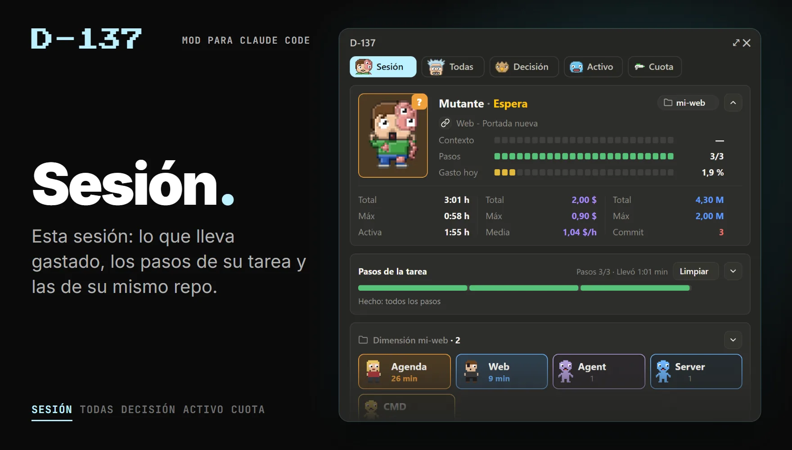
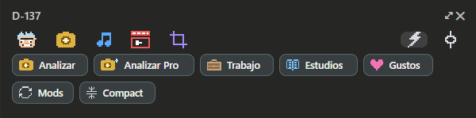

# D-137

> **In English:** a Claude Code mod that adds a panel beside the chat with every session open on your PC: what each one
> is doing, which one needs you, what is still running and how much quota you have used. The panel and this page are in
> Spanish.

**El panel de tus sesiones de Claude Code.** Un mod que pone junto al chat lo que pasa en todas las sesiones que tienes
abiertas en el PC (qué hace cada una, cuál te espera, qué sigue en marcha y cuánto llevas gastado) y, encima del
mensaje, una franja de atajos. Cada sesión es un personaje en pixel art.



*Las capturas llevan los datos de ejemplo de la prueba del mod.*

## Qué hace

Cinco pestañas, cada una con su personaje:

| Pestaña | Qué enseña |
| --- | --- |
| **Sesión** | Esta sesión: el contexto que lleva gastado, los pasos de su tarea y lo que ha gastado hoy; y, en un bloque de 3 × 3, la sesión entera: cuánto lleva abierta y trabajando, lo que habría costado por la API, sus tokens y lo que hay sin commit (o, sin git, los archivos que ha tocado). Debajo, las sesiones de su mismo repo (o de su misma rama, o las que empiezan igual de nombre: lo eliges al instalarlo), lo que corre en ellas y lo que te ha entregado, para abrirlo con un clic. |
| **Todas** | Todas las sesiones: cuáles trabajan, esperan o están bloqueadas, cuánto llevan así, quién espera a quién y lo que necesita de ti, por orden. |
| **Decisión** | Lo que te toca decidir en todas las sesiones, pregunta a pregunta, con sus opciones y la recomendada. Contestas desde aquí y la respuesta llega a su sesión como si la hubieras escrito allí. |
| **Activo** | Lo que sigue en marcha: agentes, servidores y comandos de todas las sesiones, con su última línea; abre su salida en una terminal o páralo. Y lo que han tardado y gastado los subagentes. |
| **Cuota** | La cuota: la semana, hoy y las 5 horas, si vas por encima o por debajo del ritmo de la semana, lo que gasta cada sesión (en %, en tokens o en dólares) y a qué horas lo usas. |

Y además:

- **Claude rellena el panel solo.** El mod le da una herramienta, `progreso`, y una instrucción corta: Claude cuenta ahí
  su plan, el paso en el que está y lo que te deja por decidir.
- **Dos frenos entre sesiones.** Si una va a escribir en un archivo que otra está tocando en ese momento, espera y avisa
  a la otra. Y antes de un `git restore`, `checkout`, `switch`, `stash`, `clean` o `reset --hard` que se llevaría
  cambios sin commit de otra sesión abierta, para una vez y dice qué y de quién. Los dos, solo el de git o ninguno: lo
  eliges al instalarlo.
- **La franja de atajos**, encima del mensaje: botones que escriben en la caja la skill o la orden que toca (commit,
  push…), donde esté el cursor y sin mandarla; y «Mods», que deja `/reload-plugins` escrito en todas las sesiones
  abiertas, para recargar el mod con un Enter en cada una.
- **Avisos** cuando otra sesión termina o te necesita.

Todo se queda en tu PC: el mod no se conecta a nada. Lee lo que Claude Code ya guarda en tu carpeta de usuario
(`~/.claude`) y apunta lo suyo en `~/.claude/coordinador`.

## Los personajes



Cada sesión lleva uno de los 25, el mismo mientras dure, con cuatro caras: trabajando, esperando, bloqueada y parada.
Todos, con sus cuatro caras, en [`Dibujos/Personajes`](Dibujos/Personajes).

## Instalarlo

En una terminal con Claude Code:

```
/plugin install d-137 --marketplace davidmcaru/d-137
```

Responde `y` para añadir el marketplace y elige el ámbito de usuario (el primero, con Enter). Desde la consola de tu
sistema es lo mismo:

```
claude plugin install d-137 --marketplace davidmcaru/d-137
```

En la app de escritorio de Claude: pulsa **+** junto a la caja del mensaje, luego **Plugins**, **Add marketplace** con
`davidmcaru/d-137` y, por último, **Add plugin**.

En Windows, sin GitHub: descarga el ZIP (**Code → Download ZIP**), descomprímelo donde quieras y haz doble clic en
`Instalar D-137.cmd`. Si luego mueves la carpeta, vuelve a hacerlo desde el sitio nuevo.

Al instalarlo, Claude Code te pregunta dos cosas, cada una con su desplegable:

- **Qué sesiones van juntas** en la pestaña Sesión: las del mismo repo, también desde otro worktree o en otra rama (lo
  que viene marcado); las del mismo repo y tu misma rama; o las que empiezan igual de nombre, si pones a tus sesiones
  nombres como «Web-01 Portada» y «Web-02 Menú».
- **Qué frenos quieres**: los dos, solo el de git o ninguno.

Luego se cambian en `/config`.

En la sesión donde lo instalas funciona al momento; en las que ya estaban abiertas, escribe `/reload-plugins`. El panel
se abre solo y, si lo cierras, `/marty` o `/d-137` lo vuelven a abrir.

Para quitarlo: `/plugin uninstall d-137@d-137`.

## Ponerle tus atajos



La franja viene con ejemplos, y todas sus rutas están en un archivo,
[`d-137/hooks/atajos.ts`](d-137/hooks/atajos.ts):

- **Fotos, Música, Vídeos y Recortes**, a la vista, y **Trabajo, Estudios y Gustos**, en «Más», escriben «Usa la skill
  _nombre_ (lee _ruta_): » para que acabes tú la frase. Vienen apuntando a `~/.claude/skills/<nombre>/SKILL.md`.
- **La cabeza de Doc** abre una página tuya, y **Analizar** y **Analizar Pro**, un `.cmd`. Si el archivo no está, el
  panel te dice qué ruta falta.
- **Cerrar-Tanda**, en «Commit», sigue la receta de `.claude/commands/cerrar-tanda.md` del repo antes del commit y el
  push.

Tras cambiarlo, pulsa «Mods» (en «Más») o escribe `/reload-plugins` en cada sesión.

Una orden más: `/rotulo <texto>` cambia el nombre corto de la sesión en los paneles; sin texto, vuelve al suyo.

## Requisitos

- **Claude Code con mods** (los plugins de hooks en TypeScript). Probado con la versión 2.1.309, en la app de
  escritorio y en la terminal.
- **Windows** (probado en Windows 11). En macOS y Linux no está probado: abrir archivos y carpetas, y leer las
  transcripciones de más de 4 MB, van por PowerShell y el Explorador de Windows.

Los dólares son lo que habría costado cada sesión a precio de la API, y lo de cada rato de trabajo, una estimación. Si
Claude Code aún no ha dicho cuándo se renueva tu cuota semanal, el mod supone que los lunes a las 0:00.

## Cómo está hecho

- TypeScript, sin dependencias ni imágenes: cada dibujo es una rejilla de píxeles escrita en el código y pintada en
  SVG.
- Cada sesión deja su ficha en `~/.claude/coordinador` cada 3 segundos, y el panel de cada una lee las de todas.
- Las pruebas usan el banco de pruebas de Claude Code: [`Herramientas/d-137.test.tsx`](Herramientas/d-137.test.tsx).
- Lo que hace cada parte, cómo funciona por dentro y cómo cambiarlo, en [`d-137/README.md`](d-137/README.md).

```
.claude-plugin/marketplace.json   el marketplace, para instalarlo desde GitHub
d-137/                            el mod
Herramientas/                     la prueba, la vista previa, el instalador, el que pinta los dibujos y el desfile, y
                                  el generador de los personajes (generador/, en Python)
Dibujos/                          todos los dibujos del mod, en imagen (Dibujos.html, para verlos juntos)
Capturas/                         las imágenes de este README
Instalar D-137.cmd                el instalador para Windows, sin GitHub
```

## Créditos

Lo ha hecho [David M. Carrasco Ruiz](https://davidmcaru.com)
([LinkedIn](https://www.linkedin.com/in/davidmcaru)), con Claude Code. Los personajes son pixel art hecho para el mod.

Licencia [MIT](LICENSE).
